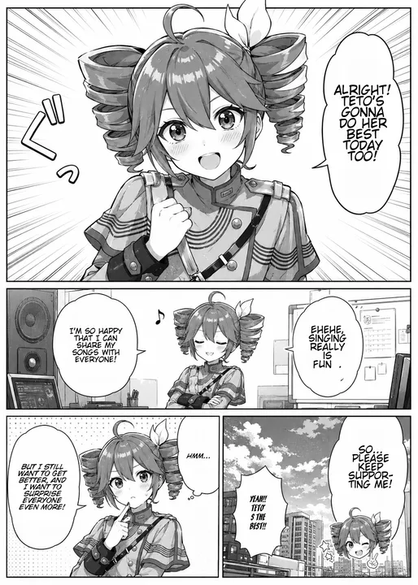

# tetolate

[Changelog](CHANGELOG.md)

tetolate is a self-hosted program to run a total end-to-end translation of mangas / comic archives. Which means, put manga in (japanese/korean/chinese), get manga out english.

It runs entirely on your computer. It is up to you (end user) to run the vision-language model (VLM) for tetolate to use.

Recommended models:
- Gemma 4 12B -- Good, on par with 26B-A4B
- Gemma 4 26B-A4B -- Good, on par with 12B
- Gemma 4 31B -- Best

NOT recommended models:
- Qwen 3.x -- Translation is too stiff and less accurate.

Please note that tetolate is designed for max quality over speed. This is NOT a real time translation software. With 40 tps on Gemma 4 31B, I see ~1 min/page for low text mangas an ~2m30/page for high text mangas.

## Example

original image genn'd by chatgpt because i don't exactly have redist permission on mangas. let me know if there's a better example!

Model: Gemma 4 31B 4bpw via ExLlamaV3, Font: Wild Words

| Original | Translated |
| --- | --- |
|  |  |

## Features

Accepts `cbz`, `zip` full of images, or a direct collection of images.

View translated pages in the browser. Generate an optional PNG, WebP, or JXL CBZ download when needed.

Web UI + password to upload, view jobs, and download.

Editor with OCR & Merge, Text & Translation, and Typesetting tabs to correct page text and layout.

## Requirements

- Native: [uv](https://docs.astral.sh/uv/) and ImageMagick 7 with PNG, WebP, and JPEG XL support. Or use Docker/Podman.
- An OpenAI-compatible vision-language model endpoint. Gemma 4 12B is considered the minimum which requires 8GB of VRAM, or offloaded to RAM which is slower. This is not a guide on running models locally; please look elsewhere for that.
- If using PaddleOCR-VL 1.6 (recommended), 2.5GB of free RAM will be occupied, and will inference on CPU
- Optional professional comic fonts. Tetolate includes open stand-in fonts when no user fonts are installed.

Native installation and Docker/Podman are first-party supported on x86-64 Linux.
ARM, Windows, and macOS are not currently tested.

## Install

Choose native installation or Docker/Podman. Both run the same pipeline and editor.

Internet is required for a first run to download the necessary models off Huggingface and Paddle.

Start an OpenAI-compatible vision-language model endpoint.

After either installation starts, open `http://127.0.0.1:8088`. Log in with
`changeme` and change the password.

NOTE: For Gemma 4, the default tokens dedicated per image is relatively low which can cause poor performance. To max tokens per image, if running via llama.cpp add `--image-min-tokens 1120`, or with ExLlamaV3 go to your model's `processor_config.json` and set

```json
"image_processor": {
    ...
    "max_soft_tokens": 1120,
    ...
}
```

### Native installation

Install uv and ImageMagick 7 with PNG, WebP, and JPEG XL support. From the source checkout, run:

```bash
./setup.sh
```

Setup installs managed Python 3.11 and the locked dependencies, checks ImageMagick, asks for model endpoints and API keys, and starts the web UI. It creates missing configuration files with mode 0600. Existing settings stay unchanged unless you choose to update them. Endpoint checks read model lists, not image inference.

Start the model services separately. Choose `paddle` for built-in OCR without an OCR inference service, or `paddleocr_vl` to use your PaddleOCR-VL endpoint.

```bash
./setup.sh --no-start  # configure and check only
./run_server.sh       # later launches; local only
```

See [BUILDING.md](BUILDING.md#native-installation) for configuration and command-line use.

### Docker/Podman

Grab the compose yaml and run the image:

```bash
curl -fsSLO https://raw.githubusercontent.com/potatoes1286/tetolate/refs/heads/main/compose.yaml
docker compose up -d
docker compose logs tetolate
```

(If using podman, simply swap out docker for podman here.)

### Configuration

#### OCR Service

There are two options for OCR. The built in PaddleOCR is quick, cheap, and not the best. For maximum quality, use PaddleOCR-VL 1.6. PaddleOCR-VL is the recommended path.

For native installation, run the OCR inference service separately and enter its
API address in setup or Advanced Options. A local service normally uses
`http://127.0.0.1:8081/v1`. Setup does not start that service.

For Docker/Podman, download the two GGUF files and chat template listed in the [model guide](data/models/README.md) into `data/models`, and run

```bash
docker compose down
docker compose --profile paddleocr-vl up -d
```

and select PaddleOCR-VL in the job's advanced options.

#### Expose to Network

Change the default password before allowing LAN access. Do not expose Tetolate to the internet.

Native launches bind to `127.0.0.1` by default:

```bash
./run_server.sh --listen               # same as --address 0.0.0.0
./run_server.sh --address 192.168.1.10  # a specific local address
```

Compose publishes port 8088 on `127.0.0.1` for local-only access. For LAN access,
change the host binding to `0.0.0.0` in `compose.yaml`. Endpoint addresses are not
rewritten: container `127.0.0.1` refers to the container, not the host. Use
`host.docker.internal` for a host service reachable from the container.

#### Fonts

tetolate bundles some open fonts for quick setup. The default setup is

```
ComicNeue-Bold.ttf: talking, narrator, general text, fallback
ComicNeue-BoldItalic.ttf: thinking, monologue, quiet internal speech
IBMPlexMono-Medium.ttf: computer text, terminal text, electronic text
ArchitectsDaughter-Regular.ttf: handwritten text, notes, letters
Bangers-Regular.ttf: sfx, loud shout, explosive or emphatic text
```

If you have your own, better, private fonts, put your files in `data/fonts` and create `font_use.txt` as described in [the font configuration guide](https://github.com/potatoes1286/tetolate/blob/main/data/fonts/README.md). The most common "Manga font" you see (and is used in the example above) is Wild Words, which is not freely available.

#### Series

Select **Is series** when creating a category. Set its translation instructions
and common ComicInfo XML under **Series settings**. Upload chapters with a chapter
number and optional volume; decimal chapter numbers are supported. Chapters run
in volume/chapter order and pass updated notes to the next chapter automatically.
Failed chapters, OCR review, or missing notes hold later chapters.

Each chapter keeps the notes it started with for retries. Edit shared notes on the
category page. You can change a completed job's volume and chapter without rerunning
translation. Old CBZ exports are removed when the numbers change.

**Export all CBZ** downloads a ZIP of PNG, WebP, or JXL CBZ files for completed
chapters. Choose individual chapters or combine chapters by volume. Chapters
without a volume stay separate. Common XML overrides matching source fields;
exports set their own title, volume, chapter number, and page count. No VLM is used.

#### Terminal access

The CLI connects to the running web server. It needs only Python's standard library.
Use `tetolate_cli.py` from the source checkout. For a container installation,
copy the client once:

```bash
podman cp tetolate:/app/tetolate_cli.py ./tetolate_cli.py
```

Then:

```bash
python3 tetolate_cli.py status
python3 tetolate_cli.py jobs list --json
python3 tetolate_cli.py jobs submit chapter.cbz --set vlm_model=YOUR_MODEL
python3 tetolate_cli.py jobs wait JOB_ID --timeout 3600
python3 tetolate_cli.py jobs logs JOB_ID --follow
python3 tetolate_cli.py jobs export JOB_ID --format webp --output chapter.cbz
```

The CLI also supports the non-editor web actions:

```bash
python3 tetolate_cli.py vlm test --category default
python3 tetolate_cli.py jobs submit --images page1.png page2.png
python3 tetolate_cli.py categories create my-series --series
python3 tetolate_cli.py series upload my-series chapter1.cbz chapter2.cbz --first-chapter 1
python3 tetolate_cli.py jobs set-translated-title JOB_ID "English title"
python3 tetolate_cli.py jobs translate-title JOB_ID
python3 tetolate_cli.py jobs retry-title-translation JOB_ID
python3 tetolate_cli.py jobs page JOB_ID 0 --kind final --output page.png
python3 tetolate_cli.py password
```

Local CLI access needs no login. Start the updated server first; the CLI reads its
private credential from `./data/jobs` or `$TETOLATE_DATA_DIR/jobs`. Use `--jobs-dir`
for another jobs directory. Inside the container, use `podman exec tetolate tetolate status`.
Local access has full control and does not create a saved login.

Remote access still needs `login --server http://HOST:8088` or a control token.
Login saves the token in `~/.config/tetolate/cli.json` (or under `XDG_CONFIG_HOME`).
Use `login --read-only` for read access and `logout` to revoke a saved token.
Tokens can also be created and revoked under **Login settings → Remote CLI access** on the admin page.

For agents, use `--json`, `--help`, and `schema --json`. Credentials can come from
`TETOLATE_SERVER_URL` and `TETOLATE_CONTROL_TOKEN`; environment values override saved
credentials. Use `--settings-file` for VLM keys. The container also includes the
client as `tetolate`.

#### Prompts

VLM prompts are plain text files in `data/prompts/`. They are read for each request, so edits apply to the next pass without restarting. See `data/prompts/README.md` for placeholder and custom-directory details.

#### Updating

Stop the server before updating. Keep the `data/` directory.

Native installation:

```bash
git pull --ff-only
./setup.sh
```

Docker/Podman:

Download the Compose file for the new version, pull its image, and recreate the container.

```bash
curl -fsSL https://raw.githubusercontent.com/potatoes1286/tetolate/refs/heads/main/compose.yaml -o compose.yaml
docker compose pull
docker compose up -d
```

## Pipeline

1. ocr_raw -- detect text with PaddleOCR or PaddleOCR-VL
2. ocr_merged -- merge nearby OCR detections with deterministic geometry
3. ocr_structured -- reject false positives, classify text, and set reading order with the VLM
4. alt_placement -- optionally classify text that must not be erased in place
5. translations -- translate each page with the VLM
6. proofreading -- optionally proofread translations in bounded batches
7. translation_notes -- optionally create reusable notes for related translations
8. placements -- determine text regions and styles
9. render -- clean text with LaMa and draw translated text with ImageMagick
10. package -- generate PNG, WebP, and JXL CBZ downloads

## Extra

Third-party software and models keep their own licenses; see [THIRD_PARTY_NOTICES.md](THIRD_PARTY_NOTICES.md).

For legal reasons, be aware that copyright exists

I vibed this with mr. codex for my own personal use. Uploaded to share. Do not expose it to WAN, etc.
